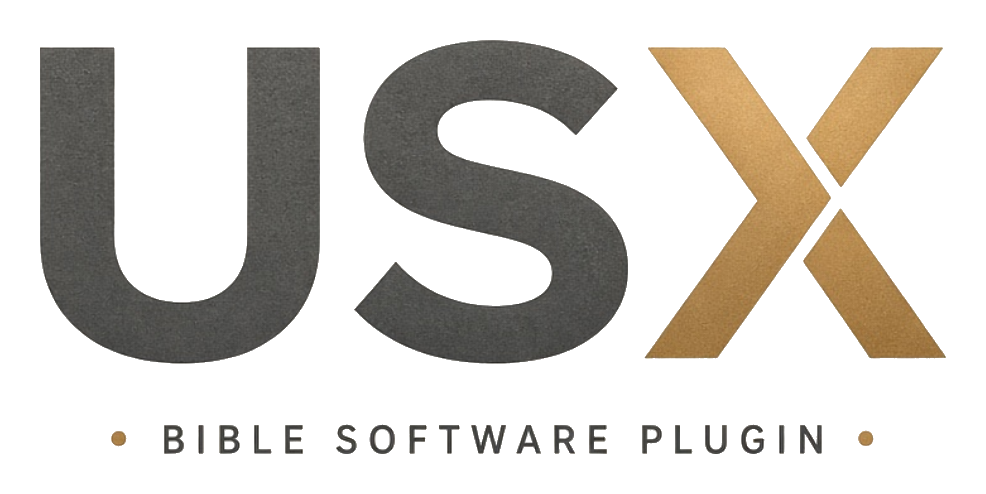

# USX



A Visual Studio Code extension for editing USX files.

It colors the scripture markers while you edit, and it opens an HTML preview of the book. The preview follows Apple’s Human Interface Guidelines: system label colors, a grouped footnote card, a segmented Page / Features control, and the system serif (New York, then `ui-serif`).

## Markers

USX stores each Paratext marker in a `style` attribute. Paratext Plugin API 2.0 describes those markers through `IParagraphMarkerInfo`, `ICharacterMarkerInfo`, and `INoteMarkerInfo`. Chapter, verse, and book are their own elements.

The preview treats common styles this way:

| Style | Kind | On the page |
| --- | --- | --- |
| `add` | Character | Italic. A translator addition. |
| `wj` | Character | Ordinary text. Features marks words of Jesus in red. |
| `f`, `fr`, `ft`, `fq` | Note | Footnote, collected at the end of the chapter. Quotations inside a note are italic. |
| `r`, `mr` | Paragraph | Italic passage reference. |
| `d`, `qd` | Paragraph | Small caps. A psalm superscription, or a Hebrew note. |
| `q1`, `q2` | Paragraph | Poetry, indented one or two levels. |
| `s1`, `s2` | Paragraph | Section headings, in italic. |
| `ms1`, `ms2` | Paragraph | Major headings, in bold italic. |
| `id`, `h`, `toc1`, `toc2`, `toc3`, `rem` | Book or paragraph | Kept in the file. Omitted from the page. |

Hover a marker in the editor for its name and page treatment. **Features** in the preview marks words of Jesus in system red and underlines translator additions. **Page** is the published appearance.

The same highlighting, hover, and preview cover the USFM 3.0.1 marker inventory: numbered markers such as `q3` and `s4`, milestone pairs (`qt-s` / `qt-e`, `ts-s` / `ts-e`), table column spans (`th1-2`), and the marker parameters `lemma`, `strong`, `srcloc`, `gloss`, `link-href`, `link-title`, `link-id`, figure `alt` / `src` / `size` / `loc` / `copy` / `ref`, milestone `sid` / `eid` / `who`, note `caller` and `category`, and peripheral `id`. A style in the `\z` namespace and an attribute that starts with `x-` are recognized as project markup. The discretionary break `//` is the `optbreak` element. A no-break space from `~` stays in the text.

## Use

Open this folder in VS Code and press F5. That launches an Extension Development Host with a sample USX file open.

In a USX file:

- Press Shift+Cmd+V to open the preview beside the editor.
- Or use the preview icon in the editor title.
- Move the cursor to scroll the preview to that verse. Click a verse in the preview to return to the source.
- Choose **Paragraph** or **Verse** in the preview. Paragraph joins consecutive prose verses into one paragraph, up to the next heading or poetry line. Verse keeps each verse on its own line. The same choice is the setting `USX: Preview: By Verse`.

Install a packaged copy with:

```bash
npm install
npx @vscode/vsce package
code --install-extension usx-0.3.4.vsix
```

## Checks

```bash
npm test
```

When a local set of USX books sits beside this project, the test renders each book.
